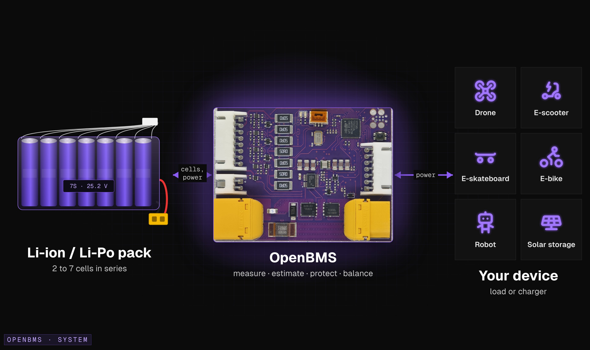
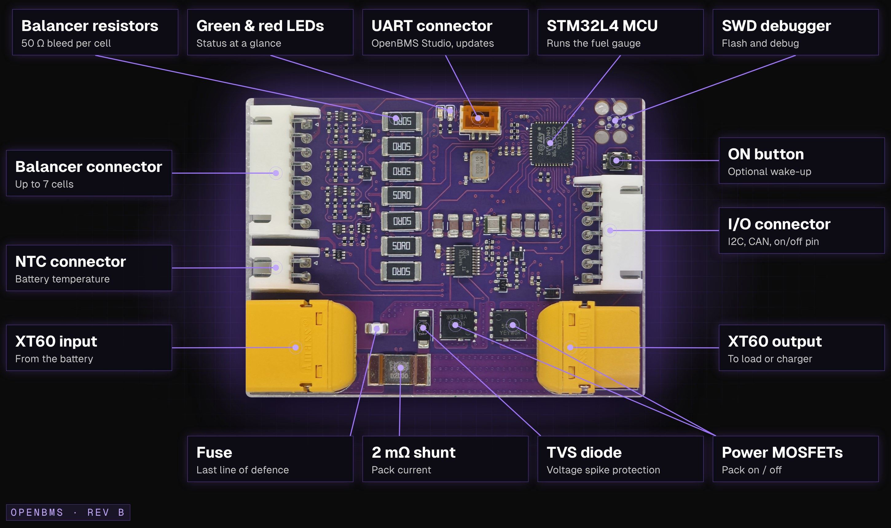
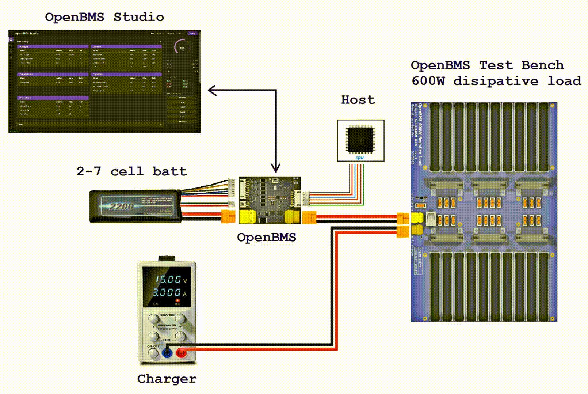
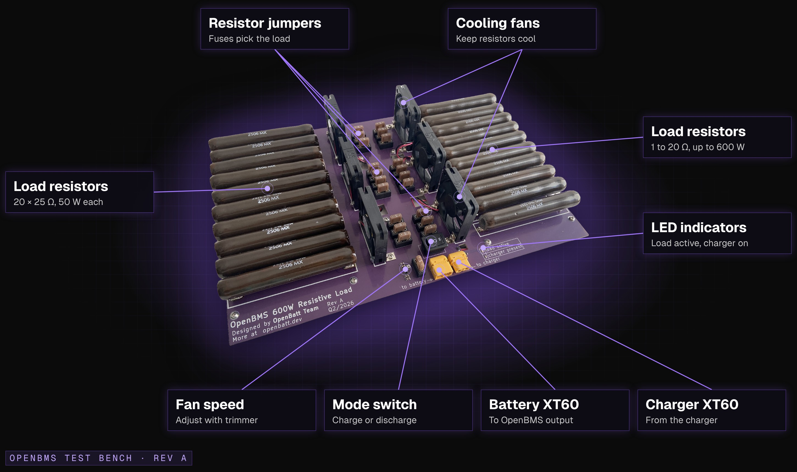

# 🔋 OpenBatt

**OpenBMS** is an open-source battery management system for 2 to 7 cell Li-ion and Li-Po packs. It learns a model of every cell, shows an accurate state of charge, balances the cells and protects the pack.

## Overview

## OpenBatt ecosystem

Hardware, firmware and software, all free, so you can safely use your battery in a quadcopter, electric skateboard, solar charger or any DIY project:

- **Li-ion/Li-Po battery** — your custom 2- to 7-cell battery
- **OpenBMS** — on-board learning test (HPPC), state of charge with self-correction, state of health and capacity learning, temperature compensation, cell balancing, 11 protections, UART, I2C and CAN
- **Test Bench** — a 600 W resistive load for the learning test and BMS development
- **Host** — your microcontroller or computer, connected over UART, I2C or CAN
- **Charger** — a CC/CV charger matched to your battery voltage and current
- **OpenBMS Studio** — PC software to configure and monitor the BMS and update its firmware over UART

## OpenBatt ecosystem in action

## OpenBMS Test Bench

A 600 W resistive load, adjustable from 1 to 20 Ω with jumpers, with cooling fans and a charge/discharge switch. It is the load for the OpenBMS learning test.

## How To Use It? (4 steps)

A short path from a bare board to a battery with accurate state of charge. The full guide with every setting is on [openbatt.dev/get-started](https://openbatt.dev/get-started).

### STEP 1 — Prepare the setup

Have everything OpenBMS needs to charge, discharge and learn your battery, and a link to your PC.

- **OpenBMS board** ([openbms-hardware](https://github.com/open-batt/openbms-hardware), firmware from [openbms-firmware](https://github.com/open-batt/openbms-firmware)) and a **2 to 7 cell Li-ion or Li-Po pack**.
- **Charger** with constant current / constant voltage (CC/CV) that gives **up to 2C** (twice the capacity).
- **Load** for about **1C** discharge. We suggest the [OpenBMS Test Bench](https://github.com/open-batt/openbms-test-bench-hardware): up to 600 W, adjustable from 1 to 20 Ω. Any resistive or electronic load also works.
- **USB to UART adapter** with 3.3 V logic levels, to connect OpenBMS to [OpenBMS Studio](https://github.com/open-batt/openbms-studio) on your PC.

> **Example: 7-cell 2000 mAh pack:** 30 V / 5 A lab power supply as charger, Test Bench with 2 resistors enabled (12.5 Ω, about 2 A), FT232 or CH340 UART adapter set to 3.3 V.

### STEP 2 — Configure OpenBMS

Tell OpenBMS what battery it protects. Connect the board to your PC and set your pack in OpenBMS Studio. The settings are saved on the board and used after a restart.

- **Pack:** number of cells in series (2 to 7) and cell capacity.
- **Cell voltage window:** maximum and minimum cell voltage, used by the learning test.
- **Protections:** over- and under-voltage, charge and discharge over-current, over- and under-temperature.
- **Charging:** full-charge cell voltage and termination current.
- **Balancing:** start voltage and the cell difference that switches balancing on.
- **Calibration:** shunt, voltage gains and NTC values (the defaults work for a standard OpenBMS board).

### STEP 3 — Run the learning test (HPPC)

Let OpenBMS measure your battery and build a model of every cell. The on-board **HPPC test** (Hybrid Pulse Power Characterisation) charges or discharges the pack in steps with short current pulses and learns from the voltage response. Run it once per pack, in two parts:

- **Charge test:** start with an empty pack and the charger connected. It learns the charge model: open-circuit voltage, internal resistance and two RC time constants over the full state-of-charge range.
- **Discharge test:** start with a full pack and the load connected. It learns the discharge model and the real capacity of every cell.

The test runs between 15 and 35 °C and with a current between 0.5C and 2C. If a protection trips or the test is stopped, nothing is saved and the test can be run again.

### STEP 4 — Ready to use!

After both learning tests OpenBMS has a model of your pack, so you never need to run the test again. Connect your real load or charger in place of the test setup.

- **Accurate state of charge** for every cell, corrected at full charge and at rest.
- **Protection and balancing** run all the time.
- **State of health:** OpenBMS keeps learning the real capacity as the pack ages.
- **Read everything** in OpenBMS Studio, or from your own microcontroller over UART, I2C or CAN.

## Links

- Website: [openbatt.dev](https://openbatt.dev)

## Related repositories

- [OpenBMS-hardware](https://github.com/open-batt/openbms-hardware)
- [OpenBMS-test-bench](https://github.com/open-batt/openbms-test-bench-hardware)
- [OpenBMS-firmware](https://github.com/open-batt/openbms-firmware)
- [OpenBMS-studio](https://github.com/open-batt/openbms-studio)

## Status: 🛠️ Work in progress

| Module | Status |
|--------|--------|
| OpenBMS Schematics & PCB Layout | ✅ Done |
| OpenBMS Test Bench Schematic & PCB Layout | ✅ Done |
| Battery Algorithms & Simulations | ✅ Done |
| Revision B (Hardware improvements, boards arrived and in testing) | ✅ Done |
| OpenBMS Firmware (STM32) | ✅ Done |
| Desktop App (OpenBMS Studio) | 🚧 In progress |
| BMS, Test Bench & Battery Tests | 🚧 In progress |
| Documentation & Final Release | 🚧 In progress |

## ❤️ Funding

This project is funded through [NGI0 Commons Fund](https://nlnet.nl/commonsfund), a fund established by [NLnet](https://nlnet.nl) with financial support from the European Commission's [Next Generation Internet](https://ngi.eu) program. 

We are very grateful to the NLnet team for helping us on our path, and we encourage you too to apply and get funds to build your project! 🚀
Learn more at the [NLnet project page](https://nlnet.nl/project/OpenBMS).
